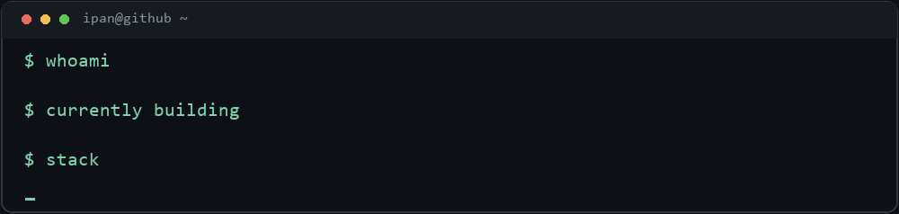

## Hey, I'm ipan.

I build web apps and enjoy figuring out how things fit together, from the database to the interface. Most of my recent work has been around PHP and Laravel, with React and TypeScript for the frontend.

Right now I'm working on [LabReserve](https://github.com/i0zfnr/labreserve), a lab booking system with reservations and admin approvals. It's still a work in progress.

### Some projects

- [**LabReserve**](https://github.com/i0zfnr/labreserve) — computer lab booking and management
- [**AttendX**](https://github.com/i0zfnr/AttendX) — PHP project
- [**AstraAi**](https://github.com/i0zfnr/AstraAi) — TypeScript project
- [**PoliSpace**](https://github.com/i0zfnr/PoliSpace) — web project

### Things I work with

`PHP`  `Laravel`  `JavaScript`  `TypeScript`  `React`  `MySQL`  `Git`

[See all repositories →](https://github.com/i0zfnr?tab=repositories)
